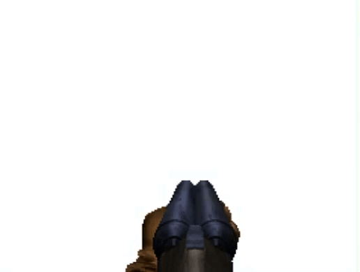

Русская версия: [README_RU.md](README_RU.md)

# REALLY COOL MOD!!!!

This is a totally badass mod for **Sprocket**!!!
Have you ever wanted to just jump out of your tank during a mission and handle things yourself?
Well, now you can do it in the coolest way possible, HEEELLL YEAAAHH!!!!
Grab a badass double-barreled shotgun and wreck those tanks yourself!!



## Requirements

- Sprocket with Mod Manager installed, or at the very least BepInEx 6 (IL2CPP) standalone (though I'm not 100% sure it will work that way)
- Badass sunglasses
- A cool, stylish cigar

## Installation

Add `SprocketDoomMod.dll` to the Mod Manager using the "Add mod" button.

Or, if you don't use the Mod Manager, copy `SprocketDoomMod.dll` to:
```
<Sprocket folder>\BepInEx\plugins\
```

## Controls

| Key | Action |
| :--- | :--- |
| `End` / `F8` | Enter badass mode |
| `W` `A` `S` `D`, Arrows | Move, air strafe |
| `Space` | Jump hell yeah |
| `Left Shift` | Sprint |
| `LMB` | Shoot |
| `B` | Switch between buckshot and slugs |
| `F9` | Weapon rendering mode: 3D mesh or 2D sprite (partially broken) |
| `F10` | Dithering overlay (looks like shit) |
| `-` / `=` | Music and SFX volume |

Also check this super cool game on roblox (i ctrl+c ctrl+v their UI bleh :P) https://www.roblox.com/games/91523839824288/brainchip-arena 
